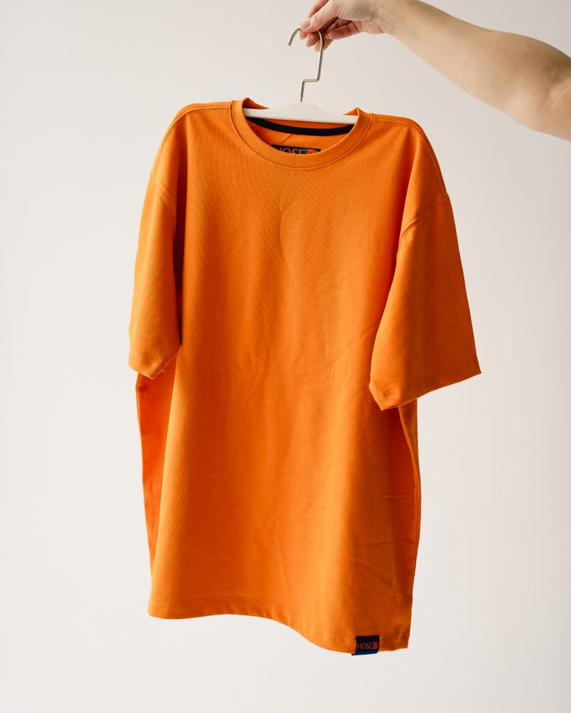
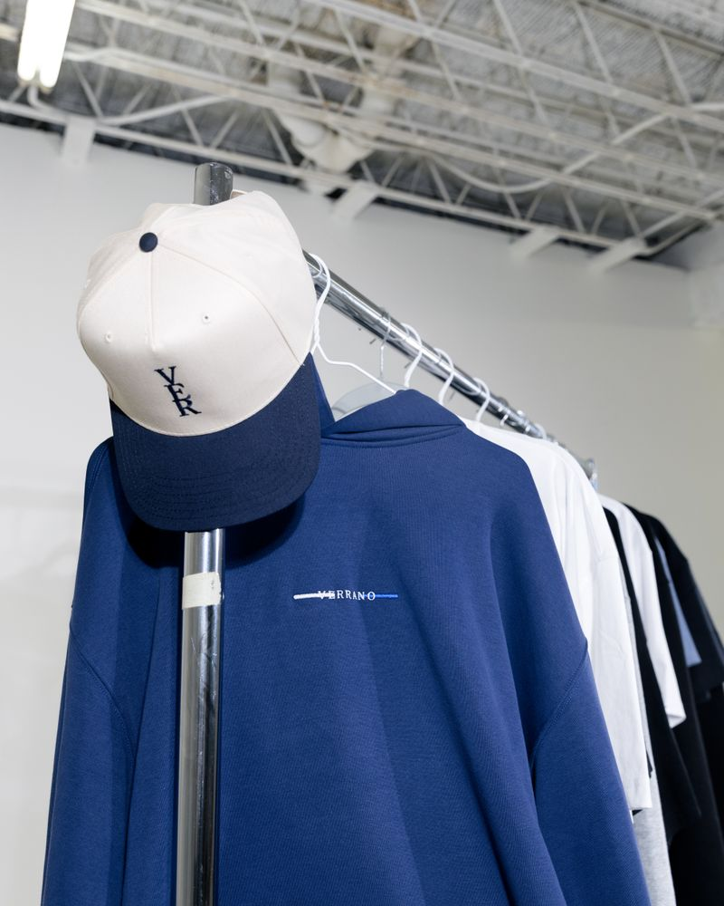

<h1 align="center">NEXAR</h1>

<p align="center"><strong>Veste o agora.</strong></p>

<p align="center">
  Loja de streetwear com vitrine 3D interativa, checkout de demonstração e painel de gestão.
</p>

<p align="center">
  <a href="https://loja-nexar.vercel.app/"><strong>Abrir a loja</strong></a> ·
  <a href="https://loja-nexar.vercel.app/produto/1/">Experimentar o 3D</a> ·
  <a href="#como-rodar-localmente">Rodar localmente</a>
</p>

<p align="center">
  <a href="https://loja-nexar.vercel.app/produto/1/"></a>
  <a href="https://loja-nexar.vercel.app/produtos/"></a>
</p>

## O que você pode fazer

| Área | Recursos |
| --- | --- |
| **Catálogo** | Buscar peças por nome e filtrar por categoria. |
| **Visualizador 3D** | Alternar entre fotos e o modelo 3D, arrastar para girar, aproximar e experimentar cores ou estampas nas peças compatíveis. |
| **Checkout** | Comprar com conta ou como visitante, escolher o envio e acompanhar o pedido por um link individual. |
| **Painel da equipe** | Gerenciar produtos, categorias e estoque, consultar pedidos e acompanhar gráficos de vendas. |

O pagamento e o rastreamento de entrega são simulados. Para testar o visualizador, abra a [Camiseta Box Logo](https://loja-nexar.vercel.app/produto/1/) e selecione **3D**.

## Como rodar localmente

Você precisa de **Git** e **Python 3.12 ou mais recente**. O passo a passo usa SQLite, que acompanha o Python.

### 1. Clone o projeto

```sh
git clone https://github.com/DevGuilherme-cpu/Loja_NEXAR.git
cd Loja_NEXAR
python -m venv .venv
```

Ative o ambiente virtual de acordo com seu terminal.

| Terminal | Comando |
| --- | --- |
| Linux ou macOS | `source .venv/bin/activate` |
| Windows PowerShell | `.\.venv\Scripts\Activate.ps1` |

Se seu sistema usa `python3` ou `py -3` para chamar o Python, use esse comando na criação do ambiente virtual.

### 2. Instale as dependências e configure o ambiente

```sh
python -m pip install -r requirements.txt
```

Em uma cópia nova do projeto, gere o arquivo `.env` na raiz com uma chave local.

```sh
python -c "from pathlib import Path; from django.core.management.utils import get_random_secret_key; Path('.env').open('x', encoding='utf-8').write(f'SECRET_KEY={get_random_secret_key()!r}\nDEBUG=True\n')"
```

O Django usa SQLite quando `DATABASE_URL` e `DB_NAME` estão ausentes ou vazias. Para configurar outro banco, consulte [`.env.example`](.env.example). Mantenha seu `.env` fora do Git.

### 3. Prepare o banco e inicie o servidor

```sh
python manage.py migrate
python manage.py popular_loja
python manage.py runserver
```

`popular_loja` preenche o banco local com produtos, fotos e pedidos de exemplo. Abra a [vitrine local](http://127.0.0.1:8000/).

Para entrar no [painel da equipe](http://127.0.0.1:8000/painel/), crie um superusuário com `python manage.py createsuperuser` e use suas credenciais. O [admin do Django](http://127.0.0.1:8000/admin/) também fica disponível.

### Testes

```sh
python manage.py check
python manage.py test loja
```

## Tecnologias e estrutura

O **Django** cuida das rotas, da autenticação e dos dados. O **Three.js** carrega os modelos **GLB** no navegador. **GSAP** e **Lenis** cuidam das animações e da rolagem.

| Caminho | Conteúdo |
| --- | --- |
| [`loja/`](loja/) | Catálogo, checkout, painel, modelos, migrações e testes. |
| [`config/`](config/) | Configuração do Django e seleção de banco. |
| [`templates/`](templates/) | Páginas da loja, da conta e do painel. |
| [`static/`](static/) | CSS, JavaScript, fotos e modelos 3D. |

O projeto aceita **SQLite** para começar, **MySQL** como alternativa local e **PostgreSQL** via `DATABASE_URL`. A loja publicada usa **Vercel** e **Supabase**. Os uploads de fotos e modelos pelo painel ficam disponíveis por padrão em desenvolvimento local com `DEBUG=True`.

## Documentação

- [Modelo de dados e diagrama entidade-relacionamento](docs/diagrama_er.md)
- [Validação do banco de dados](docs/validacao_banco.md)
- [Comportamento dos uploads na Vercel](docs/uploads_deploy.md)
- [Registro da primeira publicação do backend](docs/publicacao.md)
- [Plano original do projeto (PDF)](NEXAR_Plano_do_Projeto.pdf)

## Créditos e licença

Projeto acadêmico desenvolvido por [Guilherme](https://github.com/DevGuilherme-cpu) e [Eliton de Sousa](https://github.com/ElitondeSousa).

O código é distribuído sob a [licença MIT](LICENSE). A loja usa fotos do Pexels e um modelo de óculos do Khronos Group sob CC BY 4.0.
