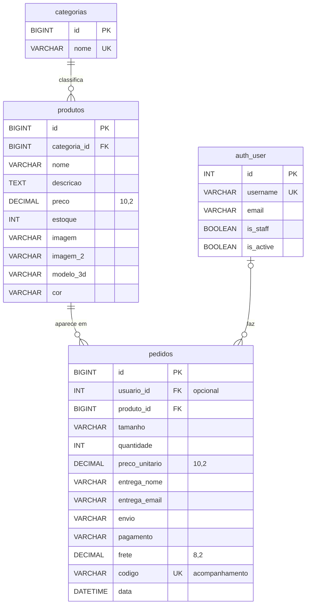

# Modelo de dados da NEXAR

O diagrama mostra os campos principais do catálogo e dos pedidos. Os nomes vêm dos [modelos da loja](../loja/models.py) e a tabela `auth_user` pertence ao Django.

- **Catálogo.** Cada produto pertence a uma categoria e registra preço, estoque, caminhos das fotos e do modelo 3D e a cor usada no visualizador.
- **Pedidos.** Cada pedido aponta para um produto e pode apontar para uma conta. Na compra como visitante, `usuario_id` fica vazio. O pedido guarda os dados de contato e envio, e o código identifica o link de acompanhamento.
- **Histórico.** O Django usa `on_delete=PROTECT` para preservar categorias com produtos, produtos com pedidos e contas vinculadas a pedidos.
- **Valores.** Cada pedido registra o preço unitário no momento da compra. O subtotal é `preco_unitario × quantidade` e o total inclui o frete.
- **Integridade.** O banco exige preços não negativos e uma quantidade mínima de uma unidade. Os nomes das categorias e os e-mails preenchidos são verificados para evitar duplicatas, desconsiderando maiúsculas e espaços nas extremidades.
