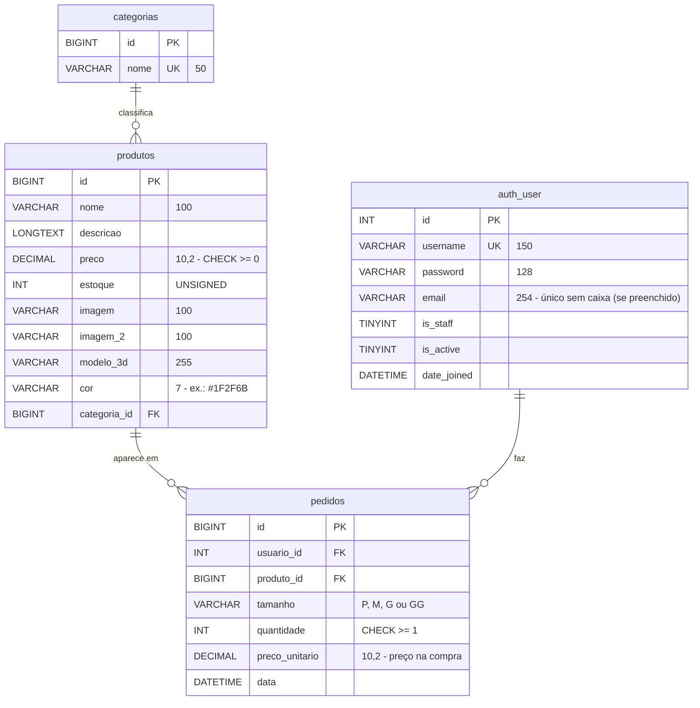

# Diagrama ER - NEXAR

`auth_user` é a tabela de usuários do próprio Django (aqui aparecem só as colunas principais).
O e-mail, quando preenchido, é único sem diferenciar maiúsculas/minúsculas (índice
`auth_user_email_ci_uniq` sobre `NULLIF(LOWER(TRIM(email)), '')`, migration `loja.0005`).
`produtos.cor` guarda a cor da peça usada no visualizador 3D (migration `loja.0002`).

**Relacionamentos.** Uma categoria tem vários produtos e cada produto pertence a exatamente uma
categoria (`produtos.categoria_id`). Um cliente (`auth_user`) faz vários pedidos, e um produto
aparece em vários pedidos; cada pedido liga um cliente a um produto (`pedidos.usuario_id` e
`pedidos.produto_id`), com tamanho e quantidade. Todas as relações são 1:N.

**PROTECT.** As três chaves estrangeiras usam `on_delete=PROTECT` no Django e, no MySQL, a FK
padrão (RESTRICT). Assim não dá para apagar uma categoria que ainda tem produtos, nem um produto
ou cliente que já tem pedidos: o histórico de vendas nunca fica com referências quebradas.

**Por que `preco_unitario`.** O pedido grava o preço do produto no momento da compra, e o total é
`preco_unitario * quantidade`. Antes o total era calculado com o preço atual do produto, então um
reajuste mudava o valor de pedidos antigos. Agora o reajuste só vale para compras novas.
CHECK constraints garantem `quantidade >= 1`, `preco >= 0` e `preco_unitario >= 0`.
